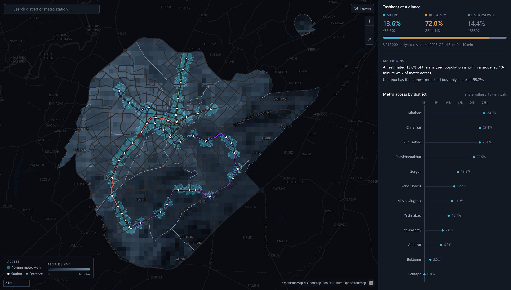
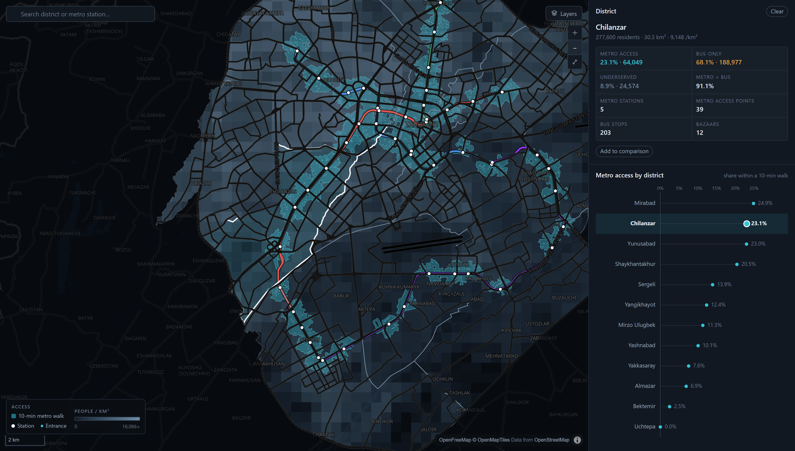
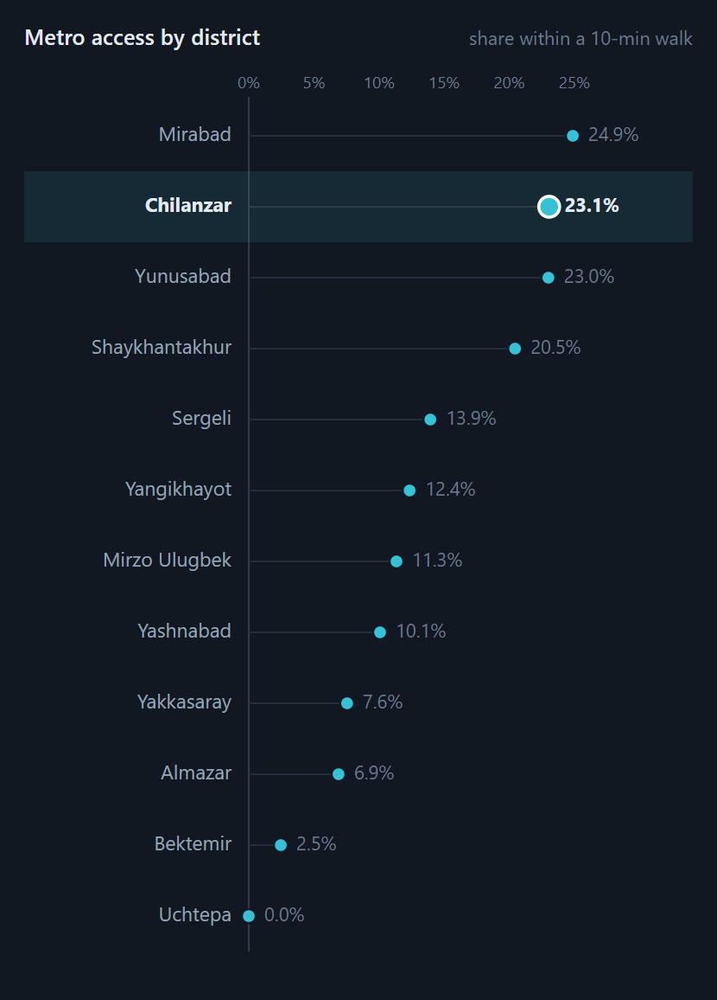
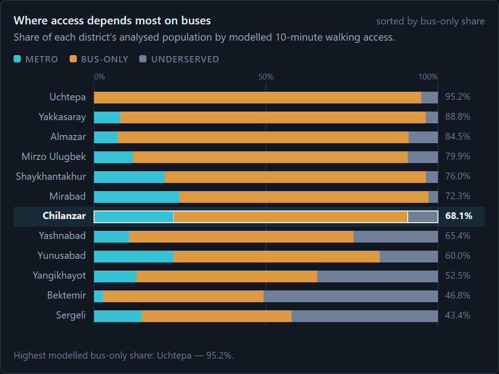
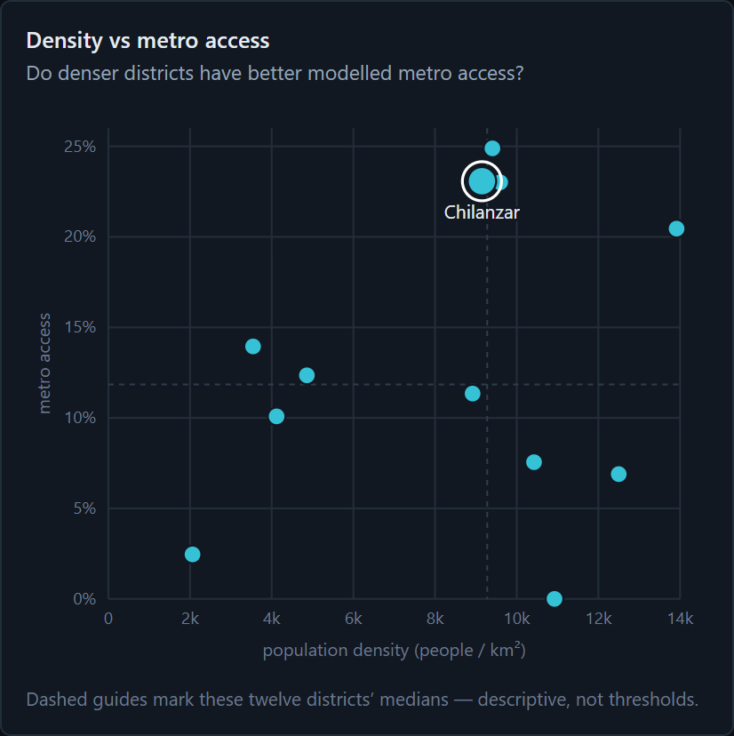
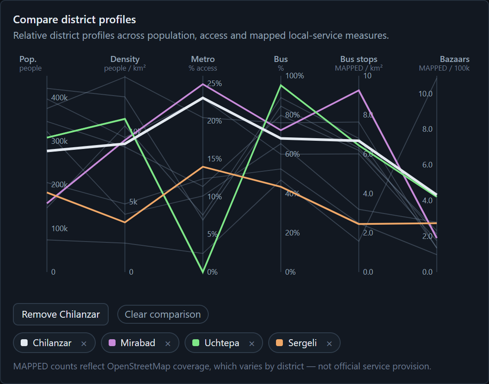
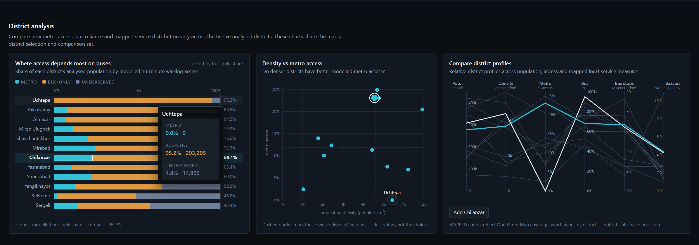
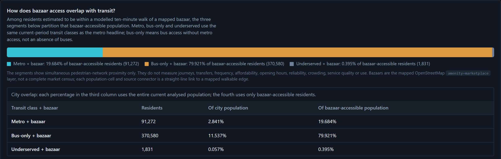
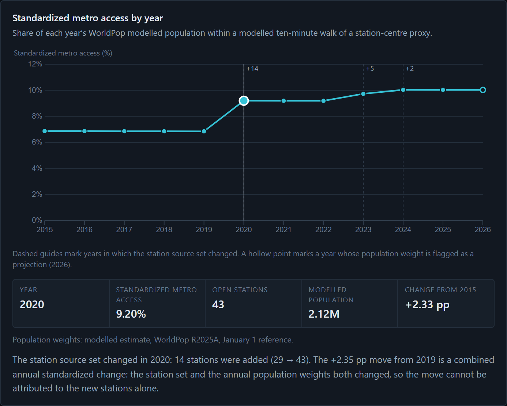

## 1. Introduction

Tashkent's metro has grown from 29 stations in 2015 to 50 today. A line on a map, however, is not the same as access on foot. Almost every metro trip begins with a walk, and whether a station is about ten minutes from home largely decides whether the metro is a realistic option. Yet public discussion rarely says how many residents live within that walk, or which neighbourhoods rely on buses instead.

Our central question is: **what share of Tashkent's population lives within a modelled ten-minute walk of the metro, and which districts depend mostly on buses?** We divide it into five questions:

1. What share of the analysed population is within a ten-minute walk of metro access?
2. Which districts have the highest and lowest metro coverage?
3. Which districts have little metro coverage and depend mostly on buses?
4. Are dense residential districts relatively underserved?
5. How does walking access to bazaars overlap with metro and bus access?

Our primary audience is Tashkent residents and commuters; secondary audiences are planners, students and journalists comparing districts. They need a trustworthy headline, a way to find their own district, and an honest sense of uncertainty.

Visualization is essential because the question is both spatial and comparative. A single percentage hides *where* access exists, and walking catchments follow streets, so their shape matters. Twelve districts with several attributes each invite ranking, part-to-whole comparison and correlation, which a table makes tedious. Linked views let readers move between the city and a single district, and keep the model's assumptions on the page rather than in a footnote.

## 2. Method

### 2.1 Data sources and acquisition

| Source | Role in the project | How it was acquired |
|---|---|---|
| OpenStreetMap (ODbL) | Pedestrian network (111,386 nodes; 154,133 undirected edges); 50 metro stations and 144 entrances; 2,163 bus stops; 83 bazaars; 436 healthcare and 1,215 education sources; district boundaries | OSMnx for the network; hand-written Overpass QL with three-mirror failover for point layers |
| SIAT dataset 3890 (CC BY 4.0) | Official 2026-Q2 district population totals (3,212,200 residents) | Portal CSV API, followed programmatically |
| WorldPop R2025A, 100 m (CC BY 4.0) | Within-district population weights; annual 2015–2026 layers | WorldPop REST API, with SHA-256 checksums recorded |
| OpenFreeMap / OpenMapTiles | Basemap only | Vector tiles at runtime |

Each acquisition script writes a JSON manifest of endpoints, timestamps, counts and checksums. The official open-data portal (data.egov.uz) was unreachable, and we did not scrape Yandex Maps because its terms do not clearly permit it, so bus stops come from OpenStreetMap alone.

### 2.2 Cleaning and filtering

- **Districts.** OpenStreetMap lists 13 districts and SIAT only 12. We matched them through a crosswalk keyed on OSM relation IDs, without fuzzy matching. Yangi Toshkent (created in 2024) has no official population, so we excluded it rather than invent a denominator. The analysis covers 12 districts and 437.7 km².
- **Metro.** Several stations are mapped twice, in Latin and Cyrillic script. Merging objects within 200 m that share a name variant reduced 56 candidates to 50, matching the official count.
- **Bus stops.** Narrow rules removed duplicate stop positions and double-mappings, but kept stops on opposite sides of a road.
- **Population.** WorldPop's district totals disagree with SIAT (correlation −0.08), so WorldPop supplies only within-district weights, rescaled to each district's official total. All distances use UTM zone 42N.

### 2.3 Transformation and analysis

Ten minutes at 4.8 km/h gives an 800 m budget, measured **along the pedestrian network** rather than as a circle. Population cells and transit points snap to the nearest walkable *edge*. An earlier nearest-vertex version could add or remove hundreds of metres on long edges, so an internal audit replaced it. Multi-source Dijkstra searches from the 154 metro access points (144 mapped entrances plus 10 station-point fallbacks) and from all bus stops give an exact network distance for each of 65,169 cells. Each cell is classified as **metro**, **bus-only** (a bus stop but no metro within the budget) or **underserved** (neither), and the classes are summed by district. The same model measures healthcare, education and bazaar access and the bazaar–transit overlap.

We tested sensitivity to walking speed (4.0 and 5.6 km/h) and to the population surface. A separate standardized 2015–2026 series holds the network fixed and varies only station openings and annual population weights. Automated tests and validation scripts check every stage.

### 2.4 Visualization technologies

The site is static HTML, CSS and JavaScript with no build step: **D3.js v7** draws the charts and **MapLibre GL JS** the vector map. A Python script converts audited outputs into compact GeoJSON and JSON with recorded hashes. One shared state store coordinates hover, selection and comparison. The site is keyboard- and screen-reader-accessible and runs on Cloudflare Workers.

## 3. Results

An estimated **13.6%** of the analysed population (about 435,690 of 3,212,200 residents) is within a ten-minute walk of metro access; **72.0%** can reach only a bus stop, and **14.4%** neither (Figure 1).

### 3.1 Interactive access map

**What it shows.** The modelled ten-minute metro catchment (teal) over a population-density grid, with metro lines, stations and entrances; bus stops and bazaars are optional layers. **Question.** Q1: where is the catchment, and who lives inside it? **What users can do.** Pan, zoom, toggle layers, search for a district or station, and click a district to zoom to it and open its profile (Figure 2). **Insight.** Metro access forms a narrow ribbon along the lines rather than a blanket, leaving large dense areas outside it. The bus-stop layer shows why the combined metro-or-bus share reaches 85.6%.

{width=16.5cm}

{width=13cm}

### 3.2 Ranked dot plot

This view sorts districts by metro-access share (Q2); hovering over or clicking a row highlights the district in every view. Shares range from 24.9% in Mirabad to 0.0% in Uchtepa. Four central districts (Mirabad, Chilanzar, Yunusabad and Shaykhantakhur) exceed 20% and together hold 62% of all metro-accessible residents. Uchtepa's zero is threshold-sensitive: its nearest population cell lies only 19.7 m beyond the 800 m budget.

{width=7.5cm}

### 3.3 100% stacked composition

This chart splits each district's population into the three classes, sorted by bus-only share (Q3), and reveals two kinds of gap. Some dense districts rely mostly on buses within walking distance: Uchtepa is 95.2% bus-only, Yakkasaray 88.8% and Almazar 84.5%. Peripheral districts instead have many residents beyond both modes: 50.7% of Bektemir, 42.6% of Sergeli and 35.1% of Yangikhayot are underserved.

{width=12.5cm}

### 3.4 Density versus access scatterplot

The scatterplot places density against metro share, with dashed median lines (Q4). If the metro followed density, the points would rise to the right; they do not (Spearman ρ ≈ 0.01, n = 12). Three of the densest districts fall in the dense, low-access quadrant: Almazar (12,500 people/km², 6.9%), Uchtepa (10,900, 0.0%) and Yakkasaray (10,400, 7.6%). Their residents are mostly bus-only rather than unserved.

{width=8.5cm}

### 3.5 Parallel coordinates

This view compares six attributes per district: population, density, metro share, bus-only share, mapped bus stops per km² and mapped bazaars per 100,000 residents. All twelve profiles stay visible as context, and users can pin up to four in distinct colours. The pinned lines cross repeatedly: Uchtepa drops to 0% on metro but tops bus-only, while Sergeli has moderate metro access, the lowest bus-only share (43.4%) and the second-highest underserved share. No district is uniformly strong or weak.

{width=10.5cm}

### 3.6 Coordinated interactions and supporting chapters

All five views share one selection store. Hovering over a district anywhere highlights it in all five, clicking selects it globally, Escape clears the selection, and tooltips give exact values (Figure 7).

{width=16.5cm}

Supporting chapters extend the story:

- **Everyday destinations** applies the same model to healthcare (46.9% within ten minutes), education (72.5%) and bazaars (14.4%).
- **Bazaar–transit overlap** answers Q5 (Figure 8): of 463,682 residents within walking distance of a mapped bazaar, 79.9% are bus-only, 19.7% also reach the metro and 0.4% reach neither.
- **A standardized 2015–2026 series** shows station-proxy access rising from 6.9% to 10.0%, with the largest step in 2020, when 14 stations opened (Figure 9). It uses a different method, so it is not compared with the 13.6% headline.
- **A District Explorer** joins one district's current profile with its history.

{width=16cm}

{width=10cm}

## 4. Discussion

### 4.1 What–Why–How

| View | What: data and attributes | Why: user tasks | How: idiom, marks, channels and interaction |
|---|---|---|---|
| Access map | Geographic catchment polygons, 500 m density grid, station and stop points, metro routes | Locate; explore the spatial distribution | Area marks; sequential luminance for density; teal hue for the catchment; point and line marks; pan, zoom, layer toggles, search and select |
| Ranked dot plot | 12 districts × 1 quantitative attribute | Rank; look up extremes | Point marks; position on a common aligned scale; sorted order |
| 100% stacked bars | 12 districts × a three-class composition | Compare part-to-whole; find mostly bus-only districts | Bar segments; length on an aligned scale; categorical hue (teal, amber, slate); sorted by bus-only share |
| Scatterplot | 2 quantitative attributes | Correlate; find outliers | Point marks; horizontal and vertical position; median reference lines; at most one label at a time |
| Parallel coordinates | 6 quantitative attributes | Compare multi-attribute profiles | Line marks across parallel axes with per-axis units; highlight hue for up to four pinned districts |

### 4.2 Strengths

Most quantitative comparisons use position on a common scale, the most accurate visual channel. Colour has one meaning throughout (teal for metro, amber for bus-only, slate for underserved), so readers learn the code once. The shared store makes five charts work as one instrument, supporting "overview first, zoom and filter, details on demand". Uncertainty stays visible: the Method dialog shows the sensitivity table, the map labels its catchment as a display layer, and denominators are named wherever they change. Every view works with a keyboard and a screen reader.

### 4.3 Weaknesses and limitations

- **Aggregation.** District averages hide variation within districts, and twelve points cannot support strong claims about relationships.
- **Parallel coordinates** are unfamiliar to many residents, and their patterns depend on axis order. Pinning reduces clutter but not the learning cost.
- **Story length.** The long, dark, text-rich page rewards careful readers but may lose casual ones, and the layout targets desktop screens.
- **The model.** The results describe modelled walking proximity, not observed travel, frequency, fares or reliability. The headline moves from 10.0% to 17.3% across walking speeds of 4.0–5.6 km/h. Incomplete OpenStreetMap data, straight-line cell connectors, ten stations without mapped entrances and the alpha-release WorldPop weights add further uncertainty.

### 4.4 Possible improvements

Next steps include an address search ("can I walk to the metro from here?"), a walking-speed slider backed by precomputed distances, neighbourhood (mahalla) aggregation, official bus-frequency data, scenarios for lines under construction, a mobile layout and usability testing with residents.

## 5. Conclusion

Our answers to the five questions are:

1. About **one in seven** analysed residents (13.6%) is within a modelled ten-minute walk of metro access.
2. Access concentrates in four central districts (20–25%); Uchtepa's 0.0% sits just 19.7 m outside the threshold.
3. For **72%** of residents, the walkable transit is a bus stop, not the metro, most of all in Uchtepa, Yakkasaray and Almazar.
4. Density does not predict metro access: several of the densest districts have below-median coverage, while residents beyond both modes live mostly on the low-density periphery.
5. Four in five residents who can walk to a bazaar are bus-only.

Together, the views turn one percentage into knowledge readers can act on. Residents can find their district and see whether the metro is realistically walkable. Planners and students can separate two kinds of gap: dense districts that rely mostly on buses, and a periphery beyond both modes. These are places where metro extensions, feeder buses or pedestrian links may be worth examining, not verdicts on service quality. Because every figure carries its assumptions and sensitivity, the project also shows how to communicate a modelled estimate transparently: what the evidence supports, and where it stops.

## References

- Boeing, G. (2017). OSMnx: New methods for acquiring, constructing, analyzing, and visualizing complex street networks. *Computers, Environment and Urban Systems*, 65, 126–139.
- Bostock, M., Ogievetsky, V., & Heer, J. (2011). D3: Data-Driven Documents. *IEEE Transactions on Visualization and Computer Graphics*, 17(12), 2301–2309.
- MapLibre contributors. MapLibre GL JS (v5.24). https://maplibre.org/
- Munzner, T. (2014). *Visualization Analysis and Design*. CRC Press.
- OpenStreetMap contributors. OpenStreetMap data, Open Database License. https://www.openstreetmap.org/copyright
- Shneiderman, B. (1996). The eyes have it: A task by data type taxonomy for information visualizations. *Proceedings of the IEEE Symposium on Visual Languages*, 336–343.
- Statistics Agency under the President of the Republic of Uzbekistan. Permanent population, dataset 3890 (2026-Q2), CC BY 4.0. https://siat.stat.uz/data/3890/?lang=en
- WorldPop (2025). Global 2015–2030 constrained population, release R2025A, Uzbekistan 100 m. doi:10.5258/SOTON/WP00839
